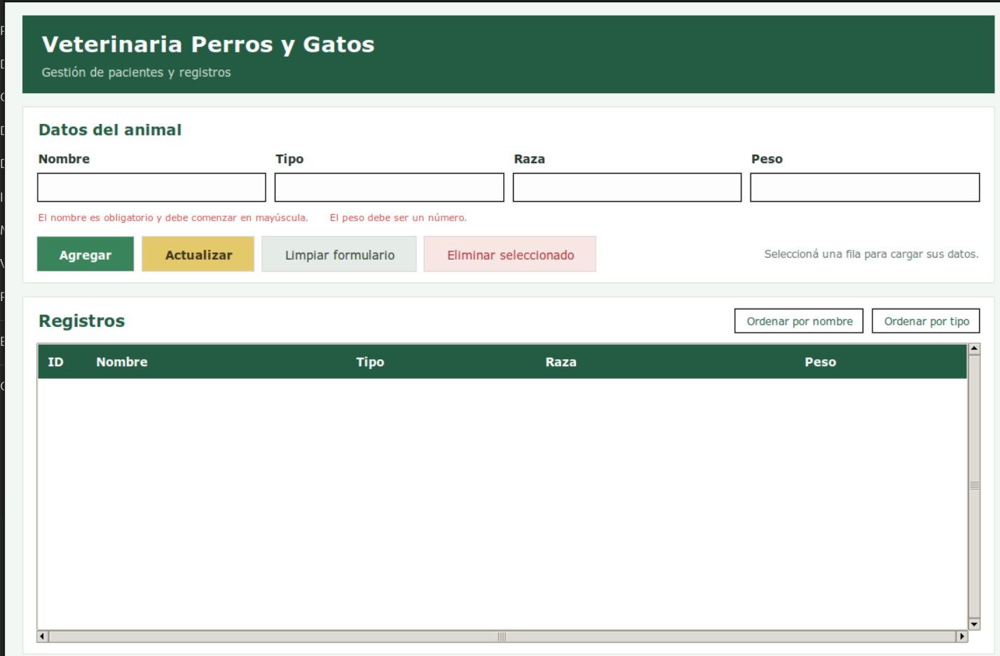
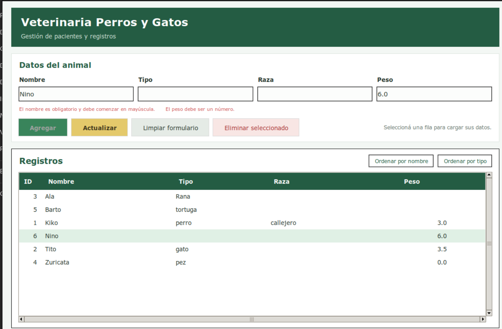

# Veterinary Management

## Abstract

Veterinary Management is a desktop application developed in Python to manage veterinary patient records. It includes CRUD operations, input validation, record sorting, and a graphical user interface built with Tkinter. The application uses SQLite for data storage and implements Object-Oriented Programming, the Model-View-Controller (MVC) architectural pattern, decorators, and the Observer design pattern.

## Descripción

Proyecto personal desarrollado como trabajo final de la Diplomatura en Python de la Universidad Tecnológica Nacional, Facultad Regional Buenos Aires (UTN BA).

La aplicación permite gestionar pacientes de una veterinaria mediante una interfaz gráfica, con operaciones de alta, modificación y eliminación de registros.

## Tecnologías

- Python 3
- Tkinter
- SQLite3
- Expresiones regulares (`re`)
- Programación Orientada a Objetos (POO)
- Patrón arquitectónico MVC
- Decoradores
- Patrón de diseño Observer
- Sphinx
- PEP 8

## Modo de uso

### Requisitos

- Python 3.
- Tkinter.
- SQLite3, incluido en la mayoría de las instalaciones estándar de Python.

### Instalación

Clonar el repositorio:

```bash
git clone https://github.com/eseoxalde/veterinary-management.git
cd veterinary-management
```

### Ejecución

Ejecutar el siguiente comando:

```bash
python3 controlado.py
```

### Operaciones disponibles

- **Agregar:** registra un paciente con nombre, tipo, raza y peso.
- **Actualizar:** permite seleccionar un registro, cargar sus datos en el formulario y modificarlo.
- **Eliminar seleccionado:** elimina el registro seleccionado.
- **Ordenar:** permite ordenar los registros por nombre o tipo.
- **Limpiar formulario:** limpia el formulario para cargar otro paciente.

El nombre es obligatorio y debe comenzar con mayúscula. El peso es opcional, pero debe ser numérico cuando se ingresa.

## Contexto académico

Este proyecto corresponde al trabajo práctico final de la Diplomatura en Python cursada en UTN BA. La consigna estaba organizada en tres niveles.

### Nivel 1: Aplicación básica

- Crear una aplicación con operaciones ABM (alta, baja y modificación) y consulta de registros.
- Capturar datos ingresados por teclado.
- Utilizar SQLite3 para almacenar información.
- Validar al menos un dato mediante expresiones regulares.

### Nivel 2: Programación Orientada a Objetos

- Aplicar el paradigma de Programación Orientada a Objetos.
- Implementar el patrón MVC.
- Incorporar manejo de excepciones.
- Documentar el proyecto con Sphinx.

### Nivel 3: Patrones de diseño y comunicación cliente-servidor

- Implementar decoradores.
- Incorporar el patrón Observer.
- Implementar un servidor que genere registros de log con información recibida desde un cliente.

## Capturas de pantalla

### Interfaz principal



### Actualización de registros



Al seleccionar un registro para modificarlo, el botón «Agregar» se deshabilita para evitar altas accidentales. Para guardar los cambios se utiliza el botón «Actualizar».

## Recursos útiles

- [PEP 8 – Guía de estilo para Python](https://peps.python.org/pep-0008/)
- [Guía de Tkinter](https://guia-tkinter.readthedocs.io/es/develop/chapters/5-basic/5.1-Intro.html)
- [Documentación de Sphinx](https://www.sphinx-doc.org/en/master/)
- [Documentación de SQLite3](https://docs.python.org/es/3/library/sqlite3.html)
- [Documentación de expresiones regulares](https://docs.python.org/es/3/library/re.html)

## Autor

**Ese Kai Oxalde**

- GitHub: [@eseoxalde](https://github.com/eseoxalde)
- LinkedIn: [eseoxalde](https://linkedin.com/in/eseoxalde/)

## Licencia

Este proyecto está distribuido bajo la licencia MIT. Consultá el archivo [LICENSE](LICENSE
) para más información.
